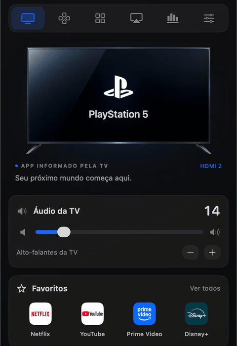
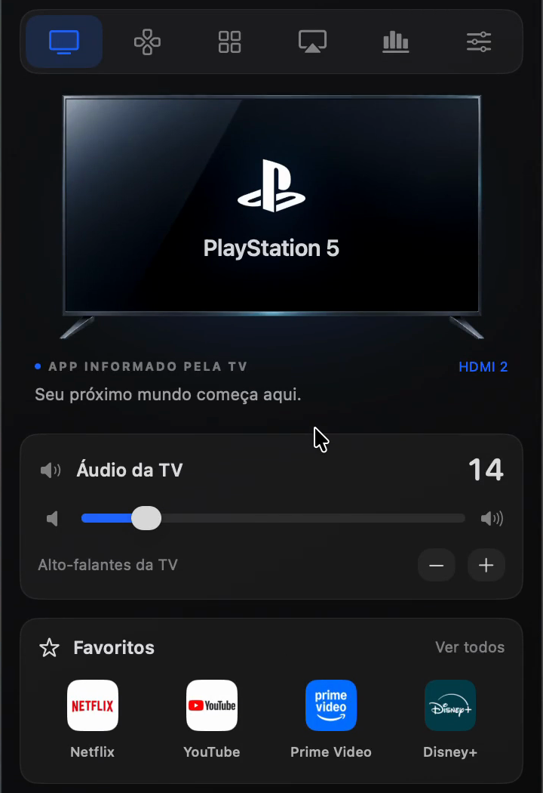
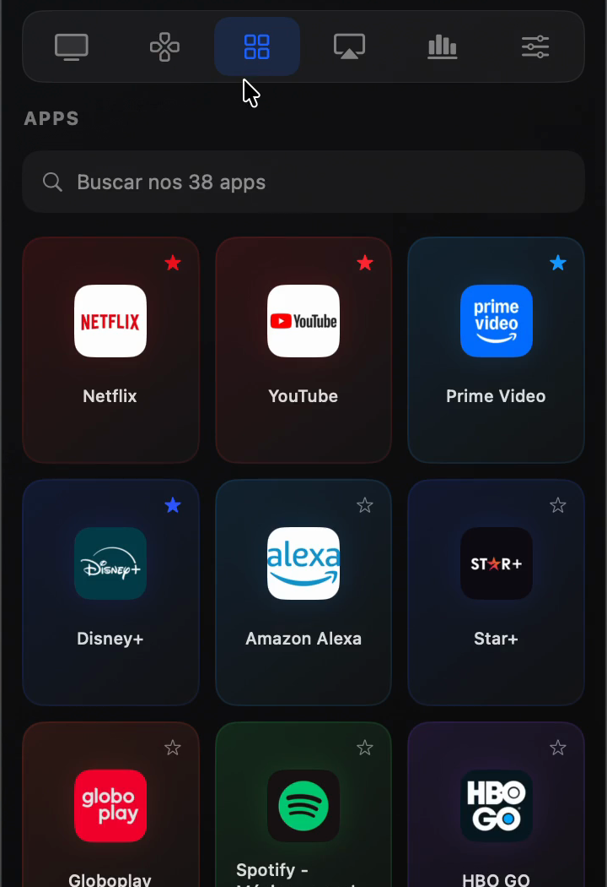

# LG webOS 5.0 · LGwebOS-menubar

A native macOS menu bar remote for LG webOS TVs. Launch apps, switch HDMI inputs, navigate with a touchpad, and keep your TV controls a click away.

The app is called **LGwebOS-menubar**. This is a community project, independent of LG.

## Preview

<p align="center">
  
</p>

| PlayStation 5 on HDMI 2 | App launcher |
| :---: | :---: |
|  |  |

<sub>Captured from an earlier build with a Portuguese interface. The current app is in English.</sub>

> **Compatibility:** the app has been tested with webOS 5.0 on one LG TV. Other models and webOS versions are not verified. If you try another TV, say so in your issue or pull request, including the model number and exact webOS version.

## Tested versions

| webOS version | Status |
| --- | --- |
| 5.0 | Works: discovery, pairing, remote control |

## Quick start with Claude

If you use Claude Code, clone this repository and tell Claude:

> Let's use this project. Set it up for my TV.

The `CLAUDE.md` file in this folder tells Claude how to build the app, find your TV's address, check compatibility, and pair. Claude will ask you for anything it cannot find, such as the TV's IP address.

## Requirements

- A Mac running macOS 14 or later.
- Xcode Command Line Tools with Swift 5.9 or later. Install them with `xcode-select --install`.
- An LG TV with webOS, on the same Wi-Fi or Ethernet network as your Mac.

## Build and run

```sh
bash scripts/build.sh
open "dist/LGwebOS-menubar.app"
```

The script builds in a temporary directory, removes debug symbols, and creates a locally signed app bundle. It does not connect to a TV. Locally built apps are not notarized, so macOS may ask you to confirm the first time you open it.

## Find your TV

- **Model:** the model number is on the TV's info screen and on the label on the back of the TV.
- **IP address:** the app can find the TV on your network, or you can enter its IPv4 address manually (it looks like `192.0.2.42`). Your router's list of connected devices also shows it. A fixed address from the router keeps it from changing.
- **MAC address (optional):** only needed for Wake-on-LAN.

The app needs an IPv4 address. Hostnames and IPv6 addresses are not supported yet.

## Connect your TV

1. Turn on the TV and make sure your Mac is on the same network.
2. Open the app from the menu bar, then open Settings.
3. Choose **Find TVs on your network**, or enter the TV's IP address from the step above.
4. Optionally enter a display name and the MAC address for Wake-on-LAN.
5. Choose **Save and connect**. Approve the certificate prompt on your Mac. A request appears on the TV: accept it.

If macOS asks for Local Network access, allow it. Discovery may not work on guest networks or networks with device isolation. In that case, enter the IP address manually.

Pairing uses encrypted WebSocket connections on port 3001. The TV certificate fingerprint and pairing key are stored in your Mac's Keychain. The app refuses a TV whose certificate has changed. To pair again after you have confirmed the TV is the same device, use **Forget pairing** in Settings.

The project ships with no TV address, device name, model, MAC address, or pairing key.

## Compatibility and limits

- **Screen time:** collected locally while the app is running, connected, and the Mac is awake. It cannot retrieve the TV's historical usage.
- **Home status:** the TV may report the underlying app while its Home overlay is visible. Home presses from this app are tracked locally. Home presses from a physical remote may not be detectable.
- **HDMI devices:** switching to a PlayStation or Chromecast switches the TV's input. It does not turn your Mac into a game controller.
- **Picture settings:** reading and changing values depends on TV permissions. Some TVs allow reading but reject changes.
- **Media casting:** playback depends on the TV's supported codecs and DLNA service. Only the selected file is served, through a temporary URL reachable from the TV and this Mac only. H.264 MP4, MP3, and JPEG are the safest choices.
- **AirPlay:** the app shows guidance for macOS Screen Mirroring. It does not start mirroring itself, and it does not capture the TV screen on the Mac.
- **Logs:** activity logs describe this app's connections and commands. Internal TV system logs and Developer Mode access are not included.
- **Wake:** requires the TV's MAC address and Wi-Fi wake enabled in the TV's settings.

## Privacy and local storage

The app has no analytics, accounts, or cloud services. TV control stays on your local network. Icons are bundled with the app.

Preferences and favorites are stored in macOS preferences. Usage and activity history are stored under `~/Library/Application Support/br.local.LGRemote/`. Pairing credentials and certificate pins are stored in Keychain, separately for each TV address. None of these runtime files are part of this repository.

## Offline checks

These run without a TV and without access to your saved pairing:

```sh
bash scripts/build.sh
"dist/LGwebOS-menubar.app/Contents/MacOS/LGwebOSMenubar" --self-check
python3 scripts/privacy-check.py
```

`--self-check` runs isolated preference, certificate, pointer, Home, usage, resource, and loopback media tests. `privacy-check.py` scans the files that would be published for local paths, device addresses, and saved pairing keys. It is a review aid, not a guarantee for every new file.

## Diagnostics

Diagnostics need an explicit TV address and do not switch inputs or launch apps. Reports contain local device information, so keep them private.

```sh
mkdir -p .local
"dist/LGwebOS-menubar.app/Contents/MacOS/LGwebOSMenubar" \
  --diagnose --host "YOUR_TV_IP" --report .local/diagnostics.json
```

For a TV that does not have a stored certificate pin yet, add `--trust-new-tv` to enable the trust prompt. Run `--help` for all options.

## Contributing

Bug reports and pull requests are welcome. Use English for code, interface text, documentation, and issues.

When you report a problem, include:

- macOS version
- TV model and exact webOS version
- Steps to reproduce
- A redacted error message

Keep IP addresses, MAC addresses, serial numbers, pairing keys, and diagnostic reports out of public issues and pull requests.

## License

MIT. See the repository [LICENSE](../LICENSE). Third-party material and brand assets are listed in [THIRD_PARTY_NOTICES.md](THIRD_PARTY_NOTICES.md).
