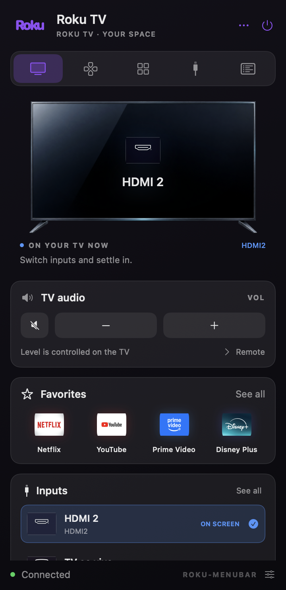
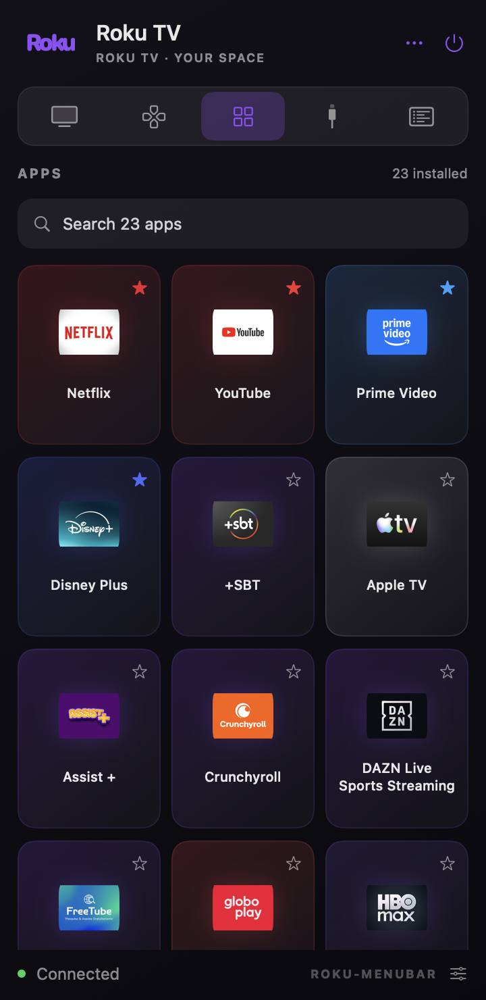

# Roku OS 15.3.4 · Roku-menubar

A native macOS menu bar remote for Roku TVs on the same local network. It discovers the TV, reads its installed channels and HDMI inputs, and uses their icons directly from the device.

Tested with Roku OS 15.3.4 on one TV. Other Roku OS versions and devices may work but have not been verified.

## Preview

| TV overview | Channel launcher |
| :---: | :---: |
|  |  |

These previews use a generic TV name. Available channels and inputs are read from your own TV at runtime.

 

## Features

- Menu bar panel with overview, full directional remote, apps, inputs, and TV details
- Live indication of the app or input currently on screen
- Dynamic app launcher with the TV's own icons and app search
- Favorites saved locally on the Mac
- Active HDMI input shown first and highlighted
- Home, Back, OK, navigation, playback, TV volume, mute, channel, and power-off controls
- Automatic discovery or manual private IPv4 address

The app sends each remote command once per click. It does not run scheduled keypresses.

## Setup

1. Connect your Mac and Roku TV to the same local network.
2. On the TV, set **Settings → System → Advanced system settings → Control by mobile apps → Enabled**.
3. Build and open the app:

   ```sh
   ./scripts/build.sh
   open dist/Roku-menubar.app
   ```

The first launch searches for a Roku TV. You can enter its private IPv4 address in Settings if discovery does not find it. macOS 14 or newer and Xcode Command Line Tools are required to build.

## Diagnostics

The read-only check prints the model, software version, app count, input count, and active app. It sends no remote command:

```sh
./dist/Roku-menubar.app/Contents/MacOS/RokuMenubar --diagnose --host YOUR_TV_IP
```

## How it works

The app uses Roku's [External Control Protocol](https://developer.roku.com/dev/docs/external-control-api) over the local network. Device discovery uses SSDP; apps, icons, device details, and the active app are queried from the TV. A click sends a single ECP request. The configured address and favorites stay in macOS UserDefaults. No cloud service, analytics, or account is used.

The Roku ECP API does not expose TV volume level or screen-time history, so the interface does not invent those values. Screen mirroring is outside this remote-control protocol.

## Privacy and distribution

The repository contains no TV address, serial number, pairing credential, or device-specific app list. The generated `.app` is ad hoc signed for local use; macOS may require you to allow it in Privacy & Security when opening a build from another machine.

This is an independent project and is not affiliated with Roku.

The repository is licensed under [MIT](../LICENSE). See [third-party notices](THIRD_PARTY_NOTICES.md) for brand assets and illustrations.
